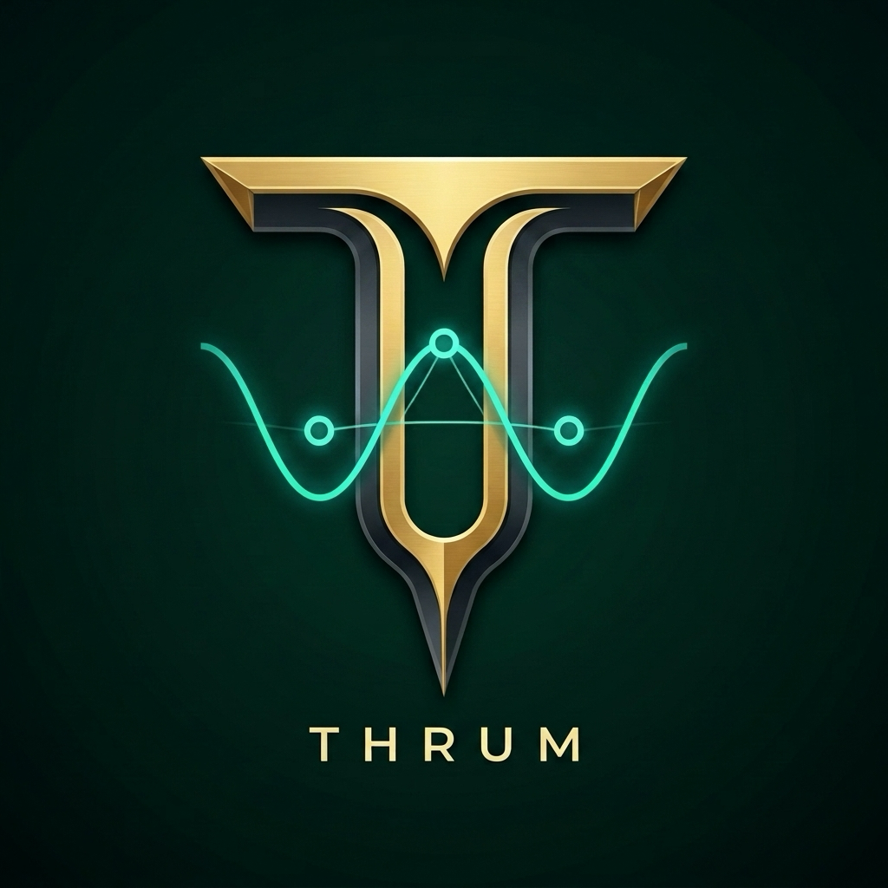

<p align="center">
  
</p>

<h1 align="center">Thrum (v0.2.0)</h1>

<p align="center">
  <strong>A programming language where values stay in tune.</strong><br>
  Self-hosted native compiler &bull; Live glitch-free reactivity &bull; SI units &amp; uncertainty propagation &bull; Object capabilities &amp; deterministic replay
</p>

---

Thrum is a reactive, dimension-checked, explainable, capability-sandboxed programming language. Programs execute natively via a **self-hosted Thrum compiler (`thrumc`)** targeting a **zero-dependency C11 runtime** (with an optional pure-Python 3.9+ reference toolchain in `thrum_lang/` and native macOS Cocoa/AppKit 2D GUI support).

## Language Highlights

- **Live reactive relations (`var`, `let`, `pin`, `live`, `settle`, `on`):** Standing equations recompute automatically in height-ordered topological waves—glitch-free, purity-checked, and with built-in mutual fixpoint relaxation (`settle`).
- **Physical quantities as the single numeric type (`72 ± 0.5 kg`, `as ft`):** Every number carries an exact 7-base SI dimension vector `(m, kg, s, A, K, mol, cd)` and first-order Gaussian uncertainty `σ` propagated through arithmetic, powers, and math functions.
- **Explainability & counterfactuals (`why`, `budget`, `whatif`):** Inspect live dependency derivation trees, rank uncertainty contributions by input, and evaluate isolated hypotheticals without mutating program state.
- **Immutable values & copy-on-write reactivity:** Typed `record`s, lists, and maps use value semantics with pattern matching (`match`/`case`), triggering reactive updates cleanly on indexed or field assignment (`p.x = 5 m`, `xs[0] = 10`).
- **Capability safety & deterministic replay (`with`, `--journal`, `--replay`):** Pure expressions and relations have **no ambient authority**; external effects (`io`, `fs`, `clock`, `rand`, `env`, `args`, `tty`, `proc`, `gui`, `net`) require explicit capabilities that can be journaled and deterministically replayed.
- **Self-hosted native binaries + macOS Desktop GUI:** Compile `.thrum` programs—including a pure-Thrum desktop **web browser** (`examples/browser.thrum`), Klondike Solitaire (`examples/solitaire.thrum`), and ANSI terminal Tetris (`examples/tetris.thrum`)—directly to standalone executables with zero Python runtime dependency.

---

## A Taste of Thrum

```thrum
use std.physics

var mass   = 70 ± 0.5 kg
var height = 1.75 ± 0.01 m

# Standing reactive relation: updates automatically whenever mass or height changes
let bmi = mass / height^2

with io:
    io.say("BMI:", round(bmi, 2))   # 22.86 ± 0.31 kg/m^2

    # Non-mutating counterfactual exploration
    whatif mass = 82 kg:
        io.say("If 82 kg:", round(bmi, 2))

    # Explain lineage and rank uncertainty contributors
    why bmi
    budget bmi
```

---

## Quickstart

### Build Standalone Toolchain & Sample Apps (macOS / C11)

```bash
make                # builds runtime/libthrumrt.a, ./thrumc, ./tetris, ./solitaire, ./browser
make bootstrap      # verifies 3-stage self-hosting fixed point (Stage 1 == Stage 2)
make app            # packages ./ThrumSolitaire.app and ./ThrumBrowser.app with AppIcon.icns
```

Run the compiled apps and compiler:

```bash
./thrumc version
./thrumc check examples/bmi.thrum
./thrumc build examples/browser.thrum -o browser
./thrumc run examples/lab_pipeline.thrum

./browser                   # launches native Cocoa GUI Thrum Web Browser
./solitaire                 # launches native Cocoa GUI Klondike Solitaire
./tetris                    # launches interactive terminal ANSI Tetris
./tetris --demo 25 --plain  # AI demo run
```

### Run Conformance & Self-Test Suites

```bash
./thrumc test                        # bundled native language self-tests
./thrumc test tests/stdlib_test.thrum
./thrumc test tests/browser_test.thrum
make test                            # native conformance, stdlib, browser, headless GUI & Python reference suites
```

### Optional Pure-Python Reference Toolchain

Thrum also ships the zero-dependency Python 3.9+ reference interpreter, formatter, AST inspector, dependency graph exporter (`--format mermaid|dot`), and REPL:

```bash
python3 thrum.py test
python3 thrum.py graph examples/bmi.thrum --format mermaid
python3 thrum.py repl
```

---

## Documentation

Thrum follows Python Software Foundation-style documentation organized by audience and depth:

| Document | Description |
| :--- | :--- |
| **[Documentation Index](docs/index.md)** | Complete documentation portal and navigation guide |
| **[What's New in 0.2](docs/whatsnew.md)** | Summary of Thrum 0.2 features, self-hosting compiler, and native GUI |
| **[The Thrum Tutorial](docs/tutorial.md)** | Guided tour from installation through reactive graphs, units, contracts, and GUIs |
| **[Language Reference](docs/reference.md)** | Exact lexical rules, data model, propagation semantics, statements, and grammar |
| **[Standard Library Reference](docs/library.md)** | Built-in functions, 13 built-in modules, 5 `std.*` modules, capabilities, and units |
| **[Compiler & Runtime Internals](docs/internals.md)** | How Thrum works: self-hosted C11 codegen, 3-stage bootstrap, GC, DAG solver, Cocoa backend |
| **[CLI, Makefile & Packaging](docs/cli.md)** | Complete reference for `thrumc`, `thrum.py`, journaling flags, and `.app` bundling |
| **[Normative Spec](SPEC.md) & [Non-Goals](NON_GOALS.md)** | Language invariants and intentional design exclusions |

---

## Project Layout

- **[`selfhost/`](selfhost/thrumc.thrum)** — Self-hosted Thrum compiler written in Thrum (`lexer`, `parser`, `checker`, `units`, `codegen_c`, `util`, `thrumc`)
- **[`runtime/`](runtime/thrum_rt.h)** — Zero-dependency C11 runtime + mark-sweep GC + reactive graph engine + native macOS Cocoa GUI & HTTPS backends (`rt_gui_cocoa.m`, `rt_net_apple.m`)
- **[`stdlib/`](stdlib/physics.thrum)** — Pure-Thrum domain modules (`std.vec`, `std.physics`, `std.signal`, `std.finance`, `std.matrix`)
- **[`examples/`](examples/browser.thrum)** — Showcase programs including the desktop Web Browser (`examples/browser.thrum`), Cocoa GUI Klondike Solitaire, terminal Tetris, N-body simulation, and thermostat fixpoint
- **[`tests/`](tests/run_native_tests.py)** — Conformance cases, native & Python test runners, stdlib tests, and browser engine tests
- **[`thrum_lang/`](thrum_lang/cli.py)** — Pure Python 3.9+ reference interpreter and developer tooling (`thrum.py`)
- **[`docs/`](docs/index.md)** — Full PSF-style language documentation book
- **[`assets/`](assets/thrum_logo.png)** — Thrum emblem logo assets

---

## License

Released under the [MIT License](LICENSE).
